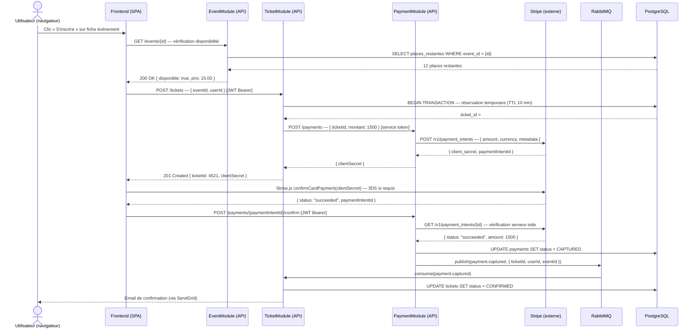
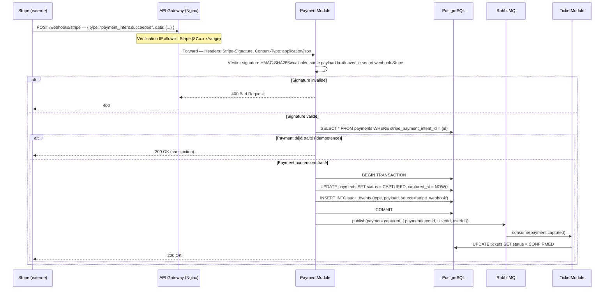

# §9 — Exigences transverses

> Document produit dans le cadre du TP 1.6 — Exigences transverses & Matrice de traçabilité SupEvents.  
> Auteur : THOMAS Alexandre  
> Projet : SupEvents — plateforme de gestion et d'inscription aux événements étudiants.

---

## §9.1 — Sécurité (analyse STRIDE)

L'analyse STRIDE est appliquée aux deux flux les plus critiques du système : le **flux d'inscription payante** (cœur du modèle économique) et le **flux de réception webhook Stripe** (point d'entrée des confirmations de paiement). Ces deux flux ont été retenus car ils sont techniquement distincts — l'un implique une session utilisateur interactive, l'autre un appel serveur-à-serveur non authentifié par session — et couvrent ensemble la quasi-totalité des vecteurs d'attaque financiers de la plateforme.

---

### §9.1.1 — Flux 1 : Inscription payante

#### Description du flux

Le diagramme ci-dessous représente le flux complet, du clic « S'inscrire » sur la fiche événement jusqu'à la confirmation du ticket après capture du paiement Stripe.

**Description du flux en prose.** L'utilisateur, préalablement authentifié (JWT valide), clique sur « S'inscrire » : le frontend interroge l'EventModule pour vérifier la disponibilité en temps réel, puis le TicketModule crée immédiatement une réservation temporaire en base avec un TTL de 10 minutes — ceci protège contre la sur-vente en conditions de concurrence. Le PaymentModule délègue ensuite la création du PaymentIntent à Stripe et renvoie le `clientSecret` au frontend ; à aucun moment les coordonnées bancaires ne transitent par nos serveurs (conformité PCI-DSS niveau 4). Le navigateur appelle directement Stripe.js pour la saisie de la carte et la confirmation 3DS si requise. Une fois le paiement confirmé côté client, le frontend notifie notre PaymentModule qui re-vérifie l'état du PaymentIntent côté Stripe (double vérification serveur-to-Stripe) avant de mettre à jour la base et de publier l'événement `payment.captured` dans RabbitMQ. Le TicketModule consomme cet événement et confirme définitivement le ticket, déclenchant l'envoi de l'email de confirmation. Ce découplage par message garantit que la confirmation n'est émise que si le paiement est effectivement capturé.

#### Tableau STRIDE

| Menace | Risque identifié | Mesure de défense retenue |
|--------|-----------------|--------------------------|
| **S — Spoofing** | Un attaquant usurpe l'identité d'un utilisateur légitime pour acheter un ticket à sa place, en rejouant un JWT volé via une connexion non-TLS. | Tous les endpoints API requièrent un JWT signé RS256 avec expiration 15 min ; le refresh token est stocké en cookie `HttpOnly SameSite=Strict` et non accessible au JavaScript. Connexion TLS 1.3 obligatoire ; toute requête HTTP est redirigée vers HTTPS (HSTS max-age=31536000). |
| **T — Tampering** | Un attaquant intercepte et modifie le montant du PaymentIntent en transit (ex. passer de 1500 à 1) pour payer moins. | Le `clientSecret` retourné par Stripe est lié au montant fixé serveur-side lors de la création du PaymentIntent ; toute modification côté client est rejetée par Stripe. La re-vérification serveur-to-Stripe (GET /v1/payment_intents) avant toute mise à jour en base garantit la cohérence du montant. |
| **R — Repudiation** | Un utilisateur conteste avoir initié l'inscription ou le paiement, rendant difficile la preuve de l'action. | Chaque étape du flux est journalisée avec horodatage, `userId`, `ticketId` et `paymentIntentId` dans un audit log en base (table `audit_events`, insertion en append-only via trigger PostgreSQL). Le `paymentIntentId` Stripe constitue une preuve externe indépendante de notre système. |
| **I — Information Disclosure** | Les données de carte bancaire de l'utilisateur sont exposées dans les logs applicatifs ou dans les réponses API. | Les coordonnées bancaires ne transitent jamais par notre infrastructure (traitement délégué à Stripe.js). Les logs applicatifs sont filtrés via un middleware qui masque tout champ `cvv`, `cardNumber`, `clientSecret`. La colonne `stripe_customer_id` en base est chiffrée au repos (AES-256 via pgcrypto). |
| **D — Denial of Service** | Un attaquant déclenche en masse des créations de tickets `PENDING` pour épuiser les places disponibles et bloquer les inscriptions légitimes. | Le TTL de 10 minutes sur les tickets `PENDING` libère automatiquement les places si le paiement n'est pas finalisé. Un rate-limiter (Nginx + Redis) limite à 5 tentatives d'inscription par utilisateur et par événement dans une fenêtre de 60 secondes. La réservation temporaire passe par une transaction PostgreSQL `SELECT FOR UPDATE` pour éviter la sur-vente. |
| **E — Elevation of Privilege** | Le service TicketModule appelle le PaymentModule avec un token qui lui permettrait d'accéder à des endpoints d'administration (ex. remboursements, annulation de tous les paiements). | La communication inter-services utilise des service tokens dédiés à portée restreinte (scopes OAuth 2.0 : `payment:create` uniquement pour TicketModule). Les endpoints d'administration (`/payments/refund`, `/payments/batch-cancel`) ne sont accessibles qu'avec le scope `payment:admin`, attribué uniquement aux identités de l'équipe ops via le provider OIDC interne. |

---

### §9.1.2 — Flux 2 : Réception webhook Stripe

#### Description du flux

Le diagramme ci-dessous représente le flux de réception du POST webhook Stripe, de l'arrivée de la requête sur notre infrastructure jusqu'à la mise à jour du statut du paiement et la publication de l'événement `payment.captured`.

**Description du flux en prose.** Stripe envoie un POST HTTP sur notre endpoint `/webhooks/stripe` dès qu'un PaymentIntent change d'état (ex. `payment_intent.succeeded`). Ce flux est fondamentalement différent du flux d'inscription : il n'y a aucune session utilisateur, aucun JWT — l'authenticité de la requête est établie uniquement par une signature HMAC-SHA256 incluse dans l'en-tête `Stripe-Signature`. La première ligne de défense est une allowlist d'adresses IP correspondant aux plages connues de Stripe, vérifiée au niveau du gateway Nginx avant même que le PaymentModule ne reçoive la requête. Le PaymentModule recalcule ensuite la signature HMAC en utilisant le payload brut (avant tout parsing JSON) et le secret webhook configuré dans les variables d'environnement — toute altération du payload invalide la signature. L'idempotence est garantie par une vérification en base avant toute mise à jour : si le paiement est déjà `CAPTURED`, on retourne simplement 200 sans rejouer l'action. Enfin, la mise à jour en base et la publication dans RabbitMQ sont réalisées dans la même transaction pour garantir la cohérence : soit les deux opérations réussissent, soit aucune.

#### Tableau STRIDE

| Menace | Risque identifié | Mesure de défense retenue |
|--------|-----------------|--------------------------|
| **S — Spoofing** | Un attaquant forged une requête POST sur `/webhooks/stripe` en imitant Stripe pour déclencher une confirmation de paiement sans paiement réel. | Vérification obligatoire de la signature HMAC-SHA256 via l'en-tête `Stripe-Signature` et le secret webhook Stripe (clé `STRIPE_WEBHOOK_SECRET` injectée en variable d'environnement, jamais en dur). En complément, allowlist IP sur les plages officielles Stripe documentées. Toute requête sans signature valide retourne 400 sans log détaillé (pas d'oracle). |
| **T — Tampering** | Un attaquant intercepte le webhook Stripe en transit et modifie le montant ou le `paymentIntentId` pour créditer un autre ticket. | La signature HMAC-SHA256 est calculée sur le payload **brut** (avant parsing JSON) : toute modification d'un seul octet invalide la signature. Le module utilise `stripe.webhooks.constructEvent(rawBody, sigHeader, secret)` avec le body non parsé — utiliser `req.body` parsé est un bug de sécurité documenté par Stripe. |
| **R — Repudiation** | Stripe conteste avoir envoyé un webhook, ou notre système ne peut pas prouver qu'un événement a été traité. | Chaque webhook reçu est loggué en base (`webhook_events` : id, type, payload_hash, timestamp, status=RECEIVED/PROCESSED/FAILED) avant tout traitement. Le `paymentIntentId` Stripe constitue une référence externe vérifiable via l'API Stripe. Les logs sont en append-only (trigger PostgreSQL bloquant UPDATE/DELETE sur la table). |
| **I — Information Disclosure** | Le payload du webhook contient des informations sensibles (email, montant, détails de carte partielle) qui sont loggués en clair dans les fichiers de log applicatifs. | Le payload complet est stocké en base (chiffré AES-256) mais uniquement le `type`, `paymentIntentId` et un hash du payload apparaissent dans les logs stdout. Le niveau `DEBUG` est désactivé en production. Les fichiers de log sont rotatifs et conservés 90 jours dans un stockage chiffré avec accès restreint à l'équipe ops. |
| **D — Denial of Service** | Stripe (ou un attaquant ayant obtenu l'URL du webhook) envoie des milliers de requêtes par seconde pour saturer le PaymentModule et rendre les confirmations de paiement impossibles. | Rate-limiter dédié sur `/webhooks/stripe` : 60 requêtes/minute par IP (au-delà : 429 avec `Retry-After`). La vérification de signature est réalisée avant toute requête en base, ce qui limite le coût des requêtes invalides. Le PaymentModule est déployé en autoscaling horizontal (min 2, max 6 instances) avec circuit breaker sur RabbitMQ. |
| **E — Elevation of Privilege** | L'endpoint webhook est accessible sans authentification ; un attaquant l'utilise comme point d'entrée pour déclencher des actions d'administration (ex. passer directement un paiement en `REFUNDED`). | L'endpoint `/webhooks/stripe` accepte uniquement les types d'événements déclarés dans une liste blanche (`payment_intent.succeeded`, `payment_intent.payment_failed`, `charge.refunded`). Tout autre type est ignoré (200 OK sans action). Les transitions d'état sont validées par une machine d'état en code (`PENDING → CAPTURED → REFUNDED` uniquement) — il est impossible de passer directement à `REFUNDED` sans passer par `CAPTURED`. |

---

## §9.2 — Performance

Les trois exigences ci-dessous sont dérivées des exigences non-fonctionnelles ENF 01 et ENF 02 du cahier des charges SupEvents. Elles sont formulées comme des SLO (Service Level Objectives) mesurables, avec solution technique, composants impactés et méthode de vérification.

---

### Exigence PERF-01 — Latence des endpoints critiques du catalogue et de l'inscription

| Dimension | Détail |
|-----------|--------|
| **Objectif mesurable** | `p95 ≤ 500 ms` sur les endpoints `GET /events` (catalogue paginé), `GET /events/{id}` (fiche événement), `POST /tickets` (création de réservation) — mesuré en conditions de charge nominale (200 utilisateurs simultanés), fenêtre glissante de 5 minutes, en excluant le temps de réponse de Stripe (appel externe non maîtrisé). |
| **Solution technique** | (1) **Cache Redis** sur `GET /events` et `GET /events/{id}` avec TTL 60 s et invalidation sur mutation (publication événement `event.updated`) ; (2) **Index PostgreSQL composite** sur `(status, date, category)` dans la table `events` pour les requêtes de filtrage du catalogue ; (3) **Index PostgreSQL** sur `(event_id, status)` dans la table `tickets` pour le comptage des places restantes ; (4) **Pagination curseur** (keyset pagination) sur le catalogue pour éviter les `OFFSET` coûteux au-delà de la page 3 ; (5) **Pool de connexions PgBouncer** (mode transaction, pool_size=20 par instance) pour éviter la saturation des connexions PostgreSQL. |
| **Composant(s) impactés** | EventModule (§7.1), TicketModule (§7.3), Redis (cache), PostgreSQL (base de données) |
| **Méthode de vérification** | Outil : **k6** (script `load-test-catalogue.js` versionné dans le dépôt). Fréquence : exécution automatique dans la CI (GitHub Actions) à chaque merge sur `main`, et en continu via un cron k6 Cloud toutes les 6 heures en production. Seuils d'alerte : alerte PagerDuty si `p95 > 400 ms` (warning) ou `p95 > 500 ms` (critical) sur une fenêtre de 5 minutes consécutives. Dashboard Grafana + Prometheus pour la visualisation temps réel. |

---

### Exigence PERF-02 — Disponibilité mensuelle de la plateforme

| Dimension | Détail |
|-----------|--------|
| **Objectif mesurable** | Disponibilité mensuelle ≥ **99,5 %** sur l'ensemble des endpoints publics de l'API (catalogue, inscription, authentification), mesurée par un outil de monitoring externe (Uptime Robot ou équivalent) avec sonde toutes les 60 secondes depuis 3 régions géographiques. La disponibilité est calculée comme le ratio `(durée_totale - durée_indisponible) / durée_totale`. **Budget d'erreur mensuel** : 99,5 % = 0,5 % d'indisponibilité tolérée. Sur un mois de 30 jours (43 200 minutes) : **0,005 × 43 200 = 216 minutes = 3 heures 36 minutes** d'indisponibilité tolérée par mois. Ce budget est partagé entre les déploiements planifiés (blue-green : ~0 downtime théorique) et les incidents non planifiés. |
| **Solution technique** | (1) **Déploiement blue-green** sur Kubernetes pour les mises à jour sans coupure de service ; (2) **Réplication PostgreSQL** en mode streaming (1 primaire + 1 réplica read) avec bascule automatique via Patroni (failover < 30 s) ; (3) **Redis Sentinel** (3 nœuds) pour la haute disponibilité du cache avec bascule automatique ; (4) **RabbitMQ en cluster** (3 nœuds, mirrored queues) pour éliminer les SPOF sur le bus de messages ; (5) **Health checks** Kubernetes (liveness + readiness probes) sur tous les pods avec restart automatique. |
| **Composant(s) impactés** | Tous les modules applicatifs (§7.1 à §7.5), PostgreSQL, Redis, RabbitMQ, infrastructure Kubernetes |
| **Méthode de vérification** | Outil : **Uptime Robot** (monitoring externe, sondes HTTPS depuis EU-West, EU-Central, US-East). Fréquence : sonde toutes les 60 secondes en continu. Seuils d'alerte : notification Slack + PagerDuty si indisponibilité > 5 minutes consécutives. Rapport mensuel de disponibilité généré automatiquement (SLO report) avec calcul du budget d'erreur consommé vs. disponible. Si le budget est consommé à plus de 80 % avant le 25 du mois, gel des déploiements non-urgents jusqu'au mois suivant. |

---

### Exigence PERF-03 — Capacité à absorber un pic d'inscriptions concurrentes

| Dimension | Détail |
|-----------|--------|
| **Objectif mesurable** | Le système doit traiter **500 inscriptions simultanées** (POST /tickets + confirmation paiement) sans dépasser `p95 ≤ 800 ms` de latence et sans aucune erreur 5xx, dans une fenêtre de 60 secondes représentant un pic d'ouverture des inscriptions pour un événement populaire. La sur-vente (tickets confirmés > capacité de l'événement) doit être nulle même sous cette charge. |
| **Solution technique** | (1) **Transaction PostgreSQL avec `SELECT FOR UPDATE SKIP LOCKED`** sur la réservation de place pour la gestion concurrente sans deadlock ; (2) **Autoscaling horizontal** du TicketModule (HPA Kubernetes : scale-out si CPU > 60 % ou file RabbitMQ > 100 messages, min 2, max 8 pods) ; (3) **File RabbitMQ avec prefetch=10** pour lisser la charge de traitement des confirmations et éviter la surcharge du TicketModule ; (4) **Circuit breaker** (Hystrix/Resilience4j) sur les appels PaymentModule → Stripe avec fallback (mise en file de la confirmation) en cas de timeout Stripe > 3 s ; (5) **Jeton de réservation temporaire** (TTL 10 min) en base pour éviter la sur-vente en cas d'abandon de paiement. |
| **Composant(s) impactés** | TicketModule (§7.3), PaymentModule (§7.4), PostgreSQL, RabbitMQ, infrastructure Kubernetes |
| **Méthode de vérification** | Outil : **k6** (script `stress-test-inscription.js`) simulant 500 VU (virtual users) en rampe de 10 secondes, avec profil d'inscription complet (GET /events/{id} → POST /tickets → confirmation). Fréquence : exécution mensuelle en environnement de staging (pré-production isolée). Critères de succès : `p95 < 800 ms`, `error_rate < 0,1 %`, zéro sur-vente vérifiée par comptage post-test. Alerte en production : si le taux d'erreur sur `/tickets` dépasse 1 % sur 2 minutes, déclenchement d'autoscaling immédiat et notification ops. |

---

## §9.3 — RGPD

### a) Registre des traitements (extrait)

Le tableau ci-dessous liste les types de données personnelles traitées par SupEvents, conformément à l'article 30 du RGPD (tenue d'un registre des activités de traitement).

| Donnée personnelle | Finalité | Base légale | Durée de rétention |
|-------------------|----------|-------------|-------------------|
| **Email** | Authentification (SSO/OIDC), envoi des confirmations de ticket, notifications d'événements | Exécution du contrat (Art. 6.1.b) | Durée du compte + 12 mois après suppression (délai légal de réclamation) |
| **Nom / Prénom** | Identification de l'utilisateur sur son profil et ses tickets, personnalisation des emails de confirmation | Exécution du contrat (Art. 6.1.b) | Durée du compte ; anonymisé à la suppression (pseudonyme stable `user_[hash]`) |
| **Identifiant SSO (sub OIDC)** | Liaison entre le compte SSO de l'école et le compte SupEvents (authentification fédérée) | Exécution du contrat (Art. 6.1.b) | Durée du compte + 12 mois |
| **Historique d'inscriptions** | Affichage de l'historique utilisateur, gestion des remboursements, audit interne | Exécution du contrat (Art. 6.1.b) + Obligation légale (Art. 6.1.c) pour les tickets payants | Tickets gratuits : durée du compte. Tickets payants : 10 ans (obligation comptable) avec anonymisation du nom après suppression du compte |
| **Identifiant customer Stripe** | Liaison entre notre système et Stripe pour la gestion des paiements et l'historique de facturation | Exécution du contrat (Art. 6.1.b) | 10 ans (conservation des données comptables) ; chiffré en base (AES-256) |
| **Adresse IP (logs d'accès)** | Sécurité (détection d'intrusion, rate-limiting, investigation d'incidents) | Intérêt légitime (Art. 6.1.f) | 90 jours, puis suppression automatique via rotation des logs |
| **Préférences de notification** | Personnalisation des communications (emails d'événements à venir) | Consentement (Art. 6.1.a) | Jusqu'au retrait du consentement ou suppression du compte |

---

### b) Mécanismes de protection transverses

- **Chiffrement TLS 1.3 en transit** : toutes les communications (client-API, API-API, API-PostgreSQL, API-Redis) utilisent TLS 1.3 avec HSTS activé (max-age=31536000, includeSubDomains). Les certificats sont renouvelés automatiquement via Let's Encrypt (cert-manager sur Kubernetes).
- **Chiffrement de la base de données au repos** : volume PostgreSQL chiffré via LUKS (AES-256) au niveau du disque. Colonnes sensibles (`stripe_customer_id`, `refresh_token_hash`) chiffrées au niveau applicatif via pgcrypto (AES-256 en mode GCM), avec clés gérées par HashiCorp Vault.
- **Hashage des refresh tokens** : les refresh tokens ne sont jamais stockés en clair — seul le SHA-256 du token est conservé en base. En cas de compromission de la base, les tokens ne peuvent pas être utilisés directement.
- **Gestion des secrets via HashiCorp Vault** : aucun secret (clés API Stripe, secrets JWT, credentials PostgreSQL, secret webhook Stripe) n'est stocké en variable d'environnement en clair dans les manifests Kubernetes. Tous les secrets sont injectés depuis Vault via le Vault Agent Sidecar, avec rotation automatique trimestrielle.
- **Séparation stricte des environnements** (développement / staging / production) : les bases de données, instances Redis, topics RabbitMQ et credentials Stripe sont entièrement distincts par environnement. Les données de production ne sont jamais copiées en développement — les jeux de données de dev sont synthétiques (Faker.js).
- **Audit log inviolable** : toutes les actions sensibles (connexion, inscription, paiement, modification de profil, exercice d'un droit RGPD) sont enregistrées dans la table `audit_events` en PostgreSQL, avec insertion en append-only (trigger bloquant UPDATE et DELETE sur la table). Les logs sont exportés vers un stockage S3 immuable (Object Lock COMPLIANCE mode) toutes les heures.
- **Minimisation des données dans les logs** : un middleware de sanitisation masque automatiquement les champs `email`, `cardNumber`, `cvv`, `token`, `clientSecret` dans tous les logs stdout avant export. Les logs sont classifiés selon leur sensibilité (PUBLIC / INTERNAL / RESTRICTED) avec accès RBAC différencié.

---

### c) Procédures liées aux droits des personnes

#### Droit d'accès (Art. 15 RGPD)

| Dimension | Détail |
|-----------|--------|
| **Qui déclenche** | L'utilisateur, depuis la page « Mes données » de son profil, ou via email à dpo@supevents.fr |
| **Qui exécute** | Script automatisé déclenché par l'utilisateur (export immédiat) pour les données structurées. Le DPO valide et supervise les cas complexes (données dans des systèmes tiers). |
| **Délai contractuel** | 30 jours calendaires maximum (Art. 12 RGPD). Objectif interne : export automatique disponible sous 24h pour les données nominatives en base. |
| **Contenu de l'export** | Fichier JSON signé contenant : profil utilisateur, historique des inscriptions (avec montants), préférences, identifiant SSO (sans mot de passe ni token). Les données Stripe (historique de facturation) sont accessibles directement via le portail Stripe de l'utilisateur (lien fourni dans l'export). |
| **Traces conservées** | Date et heure de la demande, identifiant de l'utilisateur, canal de demande (web/email), date de livraison de l'export — conservés 5 ans dans `audit_events` (preuve de conformité). |

#### Droit à l'oubli (Art. 17 RGPD)

| Dimension | Détail |
|-----------|--------|
| **Qui déclenche** | L'utilisateur, depuis la page « Supprimer mon compte », ou via email à dpo@supevents.fr |
| **Qui exécute** | Script semi-automatisé (déclenchement automatique + validation manuelle DPO pour les cas de blocage légal) |
| **Délai contractuel** | 30 jours calendaires maximum. |
| **Traitement de la tension légale** | Les données d'un utilisateur ayant effectué des paiements ne peuvent pas être intégralement supprimées — la facture associée doit être conservée 10 ans (Art. L123-22 Code de commerce). **Résolution** : (1) Le nom, l'email et l'identifiant SSO de l'utilisateur sont remplacés par un pseudonyme stable `anon_[SHA256(userId)[:12]]` dans toutes les tables (profil, tickets, paiements). (2) La facture et l'historique de paiement sont conservés avec ce pseudonyme stable — la donnée comptable est préservée sans identification de la personne physique. (3) Le customer Stripe est dissocié du compte (le lien `stripe_customer_id` est supprimé de notre base, mais la donnée reste chez Stripe pour les 10 ans réglementaires). (4) Les tokens actifs (JWT, refresh tokens) sont révoqués immédiatement dans Redis. |
| **Données interdites de suppression** | Factures et tickets payants (10 ans, obligation comptable) — anonymisés mais conservés. Logs d'audit de sécurité (90 jours, intérêt légitime). |
| **Traces conservées** | Date de la demande, pseudonyme résultant, liste des tables impactées, confirmation d'exécution — conservés dans `audit_events` (preuve de conformité, 5 ans). |

#### Droit de rectification (Art. 16 RGPD)

| Dimension | Détail |
|-----------|--------|
| **Qui déclenche** | L'utilisateur, depuis la page « Modifier mon profil », ou via email à dpo@supevents.fr pour les données non modifiables via l'interface |
| **Qui exécute** | Modification directe via l'interface utilisateur pour email et nom/prénom. Pour les données propagées à des tiers, traitement semi-manuel par le DPO. |
| **Délai contractuel** | Modification via interface : immédiate. Rectification nécessitant des tiers : 30 jours calendaires. |
| **Traitement des données propagées** | (1) **Email chez SendGrid** : mise à jour automatique via l'API SendGrid (`PUT /v3/contactdb/recipients`) lors de la modification en base. (2) **Email chez Stripe** : mise à jour via l'API Stripe (`POST /v1/customers/{id}`) si un customer Stripe est associé. (3) **Identifiant SSO** : non modifiable par l'utilisateur (géré par le système d'information de l'école) — l'utilisateur est redirigé vers le support informatique de l'établissement. |
| **Traces conservées** | Valeur avant modification, valeur après modification, date, canal de demande — conservés dans `audit_events` (5 ans). |
